<p align="center">
  
</p>

<h1 align="center">CKAN Brand & Marketing Assets</h1>

<p align="center">
  The official home for CKAN logos, colours, illustrations and templates.<br>
  <strong>Looking for the CKAN logo? You're in the right place.</strong>
</p>

<p align="center">
  <a href="#-logos">Logos</a> ·
  <a href="#-how-to-use-the-logo">Logo usage</a> ·
  <a href="#-colour-palette">Colours</a> ·
  <a href="#-typography">Typography</a> ·
  <a href="#-illustrations">Illustrations</a> ·
  <a href="#-social-media">Social media</a> ·
  <a href="#-presentations--one-pager">Slides</a> ·
  <a href="#-ckan--20">CKAN @ 20</a>
</p>

---

## ⚡ Quick start

| I need… | Use this |
|---|---|
| The CKAN logo for a website, README or docs | [`logos/primary/svg/ckan-logo.svg`](logos/primary/svg/ckan-logo.svg) |
| A PNG logo for a doc, email or slide | [`logos/primary/png/ckan-logo.png`](logos/primary/png/ckan-logo.png) |
| A logo for a dark background | [`logos/variants/ckan-logo-white.png`](logos/variants/ckan-logo-white.png) |
| A logo for one-colour / grayscale print | [`logos/variants/ckan-logo-greyscale.png`](logos/variants/ckan-logo-greyscale.png) |
| Just the paper boat (avatar, favicon, sticker) | [`logos/variants/ckan-boat-icon.png`](logos/variants/ckan-boat-icon.png) |
| To show CKAN is a Digital Public Good | [`logos/dpg/svg/ckan-dpg.svg`](logos/dpg/svg/ckan-dpg.svg) |
| A slide deck | [CKAN Presentation Template](https://docs.google.com/presentation/d/1f1lsECJ4IaMFqVmalPlWvv9UU7NQ3RrweWaP1QZ1jbA/edit) |
| The full brand guidelines | [CKAN Branding Guidelines 2026](https://docs.google.com/presentation/d/1QNzKmlIL-nYNwu06l2-ZnKbS6-orjtFVprx9EQKH6VA/edit) |

> **Tip:** Always prefer **SVG** when the tool supports it. It stays sharp at any size and is tiny on disk. Use PNG only where SVG isn't accepted.

To download a single file, open it on GitHub and click **Download raw file**. To get everything, use **Code → Download ZIP**.

---

## 🛶 Logos

The CKAN logo is made of two parts: the **paper boat icon** and the **`ckan` wordmark**. The paper boat stands for navigation, journey and data discovery, which is what CKAN does: it helps organisations find their way through their data.

| Element | Colour | Meaning |
|---|---|---|
| Yellow sail | CKAN Yellow `#EAE735` | Energy, optimism |
| Coral sail | CKAN Coral `#ED5248` | Action, importance |
| Blue hull | Sky scale `#D4E5F1` → `#95B0C4` | Trust, reliability |

### Primary logo

<table>
  <tr>
    <th width="50%">Full colour: default, on light backgrounds</th>
    <th width="50%">White: on dark backgrounds</th>
  </tr>
  <tr>
    <td align="center">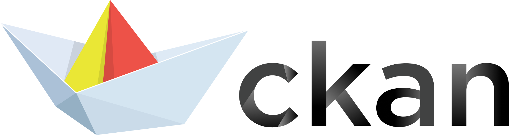</td>
    <td align="center">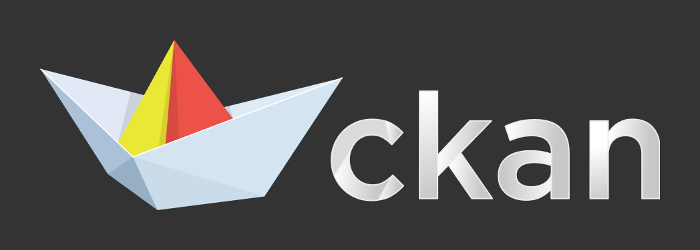</td>
  </tr>
  <tr>
    <td>
      <a href="logos/primary/svg/ckan-logo.svg">SVG</a> ·
      <a href="logos/primary/png/ckan-logo-small.png">PNG 334 px</a> ·
      <a href="logos/primary/png/ckan-logo.png">PNG 1926 px</a> ·
      <a href="logos/primary/png/ckan-logo-large.png">PNG 2846 px</a>
    </td>
    <td><a href="logos/variants/ckan-logo-white.png">PNG 928 px</a></td>
  </tr>
  <tr>
    <th>Greyscale: when colour isn't available</th>
    <th>Boat icon: when space is tight</th>
  </tr>
  <tr>
    <td align="center">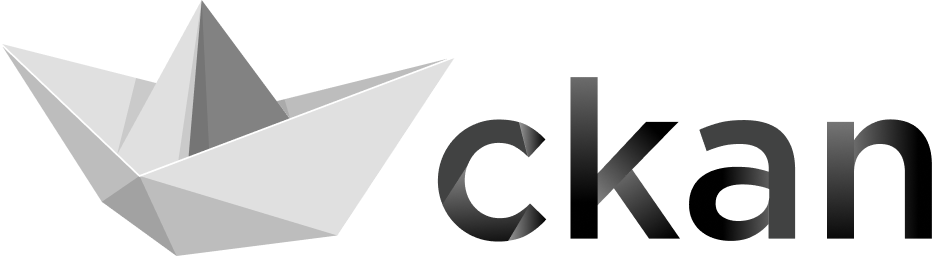</td>
    <td align="center"></td>
  </tr>
  <tr>
    <td><a href="logos/variants/ckan-logo-greyscale.png">PNG 932 px</a></td>
    <td><a href="logos/variants/ckan-boat-icon.png">PNG 8297 px</a> (high-res, transparent)</td>
  </tr>
</table>

### CKAN Extensions

For the extensions ecosystem and content about building or using CKAN extensions.

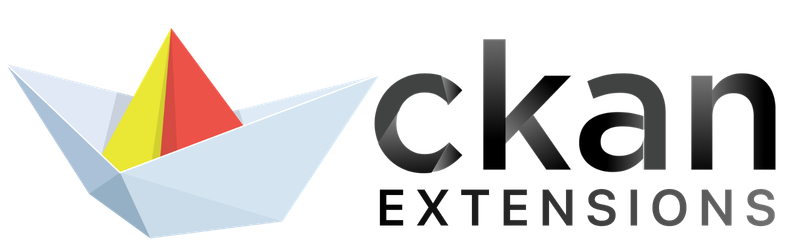

[PNG, transparent](logos/extensions/ckan-extensions-logo.png) · [PNG, white background](logos/extensions/ckan-extensions-logo-white-bg.png)

### CKAN · Digital Public Good

CKAN is a recognised [Digital Public Good](https://digitalpublicgoods.net/). Use this lockup on pages, decks and proposals where DPG status matters (for example government, NGO and development-sector audiences).

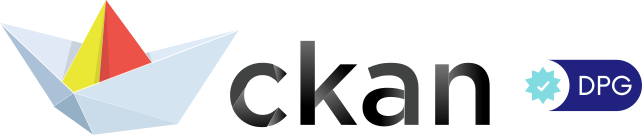

[SVG](logos/dpg/svg/ckan-dpg.svg) · [PNG @1x](logos/dpg/png/ckan-dpg.png) · [@2x](logos/dpg/png/ckan-dpg@2x.png) · [@3x](logos/dpg/png/ckan-dpg@3x.png) · [@4x](logos/dpg/png/ckan-dpg@4x.png)

---

## 📐 How to use the logo

### Clear space

Leave empty space around the logo equal to at least **X**, where **X is the height of the boat icon**. Keep text, images and the edges of the frame out of that area.

### Minimum size

| Medium | Minimum size |
|---|---|
| Digital | **80 px** |
| Print | **25 mm** |

Below that size, use the boat icon on its own.

### Picking the right version

| Background | Use |
|---|---|
| White or light (including the Sky 100–200 tones) | Full colour |
| Dark or photographic | White |
| One-colour print, fax, engraving, stamps | Greyscale |
| Square or very small spaces (avatars, favicons) | Boat icon |

### ✅ Do

- Use the files in this repo as they are.
- Scale the logo proportionally (hold <kbd>Shift</kbd> while resizing).
- Make sure there's enough contrast between the logo and what's behind it.
- Write the name as **CKAN** (all caps) in running text. The lowercase `ckan` is part of the logo artwork only.

### ❌ Don't

| | |
|---|---|
| ❌ Stretch, squash or distort the logo | ❌ Rotate or tilt it |
| ❌ Add effects such as shadows, glows, outlines or 3D | ❌ Change or recolour the sails, hull or wordmark |
| ❌ Rearrange, resize or separate the icon and wordmark into a new lockup | ❌ Place the full-colour logo on busy or low-contrast backgrounds |
| ❌ Recreate the logo in a different typeface | ❌ Combine it with another logo so it looks like a single mark |

### Using the CKAN name and logo for your own project

Community members are welcome to use the logo to **refer to CKAN**: for example, "Powered by CKAN" on a portal, in a talk about your CKAN deployment, or in an article about the project.

Please don't use it in a way that suggests your product, service or organisation **is** CKAN or is officially endorsed by the CKAN project, unless that's been agreed. If you're not sure, [open an issue](https://github.com/ckan/ckan-marketing/issues/new) and ask.

> These are visual usage guidelines. Wider trademark guidelines for the CKAN name are a separate topic.

---

## 🎨 Colour palette

### Primary

| | Name | HEX | RGB | CMYK | Use for |
|---|---|---|---|---|---|
|  | **CKAN Yellow** | `#EAE735` | 234, 231, 53 | 7, 0, 89, 0 | Energy, highlights, illustration accents |
|  | **CKAN Coral** | `#ED5248` | 237, 82, 72 | 0, 80, 70, 0 | Calls to action, links, emphasis |

### Secondary

Darker versions of the primary colours, used for hover and pressed states and to add depth.

| | Name | HEX | RGB | CMYK |
|---|---|---|---|---|
|  | Yellow Dark | `#D2CF30` | 210, 207, 48 | 18, 0, 95, 0 |
|  | Coral Dark | `#D54A41` | 213, 74, 65 | 0, 82, 75, 5 |

### Foundation

| | Name | HEX | RGB | CMYK | Use for |
|---|---|---|---|---|---|
|  | Black | `#333333` | 51, 51, 51 | 0, 0, 0, 80 | Body text, headlines, high-contrast elements |
|  | White | `#FFFFFF` | 255, 255, 255 | 0, 0, 0, 0 | Backgrounds, text on dark surfaces, negative space |

### Neutral scale: Sky

A blue-grey scale for backgrounds, containers, dividers and subtle UI. Use **100–200** for page backgrounds and **400–500** for secondary text and icons.

| | Name | HEX | RGB | CMYK |
|---|---|---|---|---|
|  | Sky 100 | `#E0E9F5` | 224, 233, 245 | 10, 4, 0, 0 |
|  | Sky 200 | `#D4E5F1` | 212, 229, 241 | 14, 4, 0, 0 |
|  | Sky 300 | `#CADBE9` | 202, 219, 233 | 16, 6, 0, 0 |
|  | Sky 400 | `#ABC1D7` | 171, 193, 215 | 26, 12, 0, 0 |
|  | Sky 500 | `#95B0C4` | 149, 176, 196 | 32, 14, 6, 0 |

> **Accessibility:** CKAN Yellow has very low contrast against white, so don't use it for text or thin lines on light backgrounds. Use it for fills, shapes and accents. For text, use Black `#333333`. Coral works for large text and buttons. Check small text with a contrast checker.

<details>
<summary>Copy as CSS variables</summary>

```css
:root {
  /* Primary */
  --ckan-yellow: #EAE735;
  --ckan-coral: #ED5248;
  /* Secondary */
  --ckan-yellow-dark: #D2CF30;
  --ckan-coral-dark: #D54A41;
  /* Foundation */
  --ckan-black: #333333;
  --ckan-white: #FFFFFF;
  /* Neutral: Sky */
  --ckan-sky-100: #E0E9F5;
  --ckan-sky-200: #D4E5F1;
  --ckan-sky-300: #CADBE9;
  --ckan-sky-400: #ABC1D7;
  --ckan-sky-500: #95B0C4;
}
```
</details>

---

## 🔤 Typography

CKAN uses **SF Pro Display** across brand materials, from headlines and body text to captions and interface elements.

| Weight | Use |
|---|---|
| Regular 400 | Body text, captions |
| Medium 500 | Subheadings, labels, UI |
| Bold 700 | Headlines, emphasis |

| Style | Size |
|---|---|
| H1 | 48 px |
| H2 | 36 px |
| H3 | 28 px |
| H4 | 20 px |
| Body | 16 px |
| Small | 14 px |
| Caption | 12 px |

Download: [SF Pro on Apple Developer](https://developer.apple.com/fonts/) (review the licence terms before use).

---

## 🖼 Illustrations

Line-art illustrations with black outlines and a consistent stroke weight, which gives them a friendly, hand-drawn feel. Each one includes the CKAN paper boat and uses the brand palette. They work well for blog headers, landing pages, slides and social posts.

| | | |
|:---:|:---:|:---:|
| 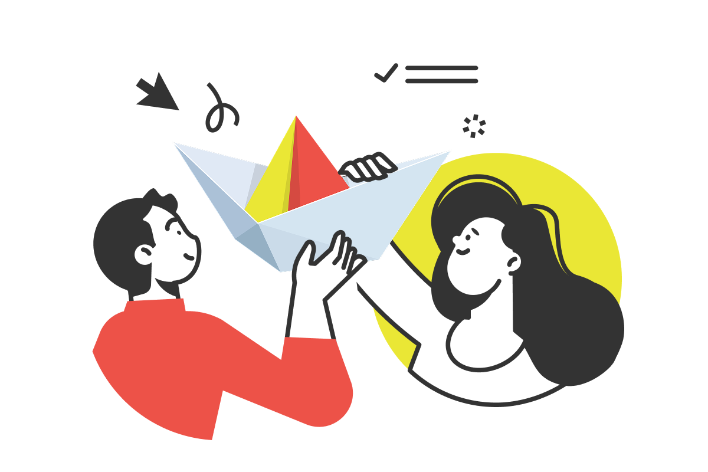<br>`collaboration-1` | 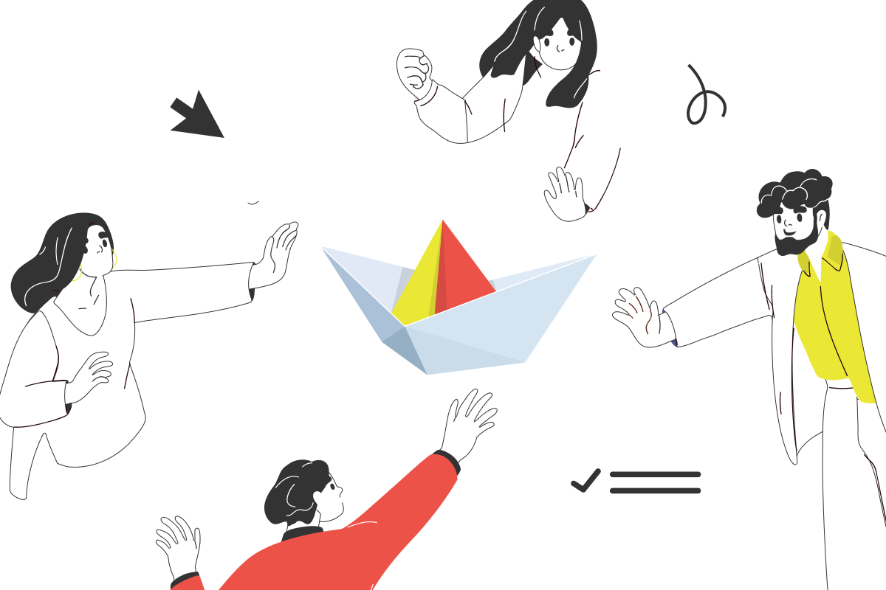<br>`collaboration-2` | 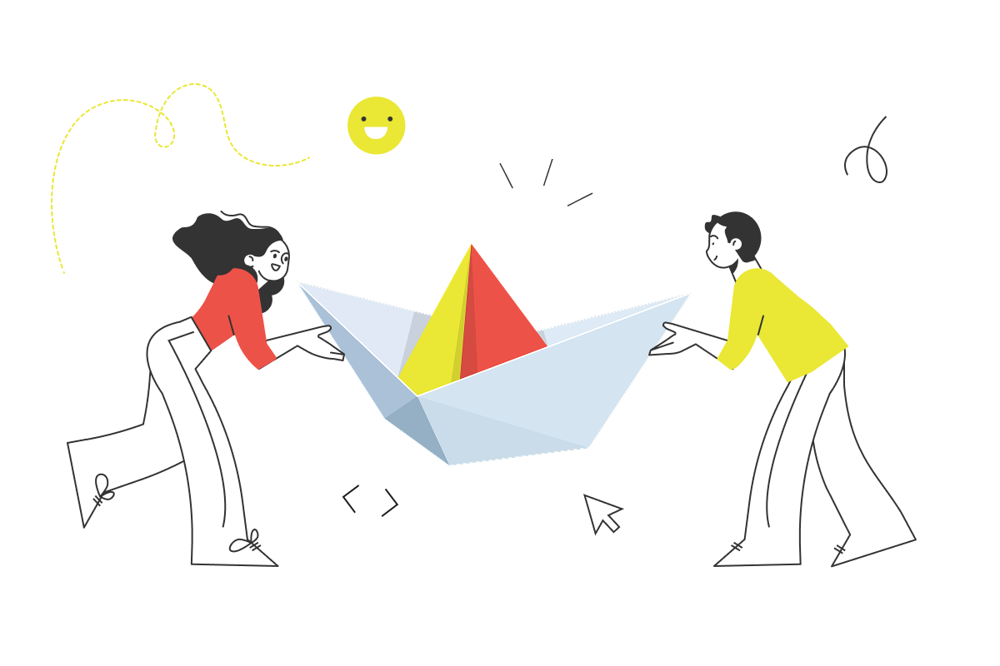<br>`collaboration-3` |
| 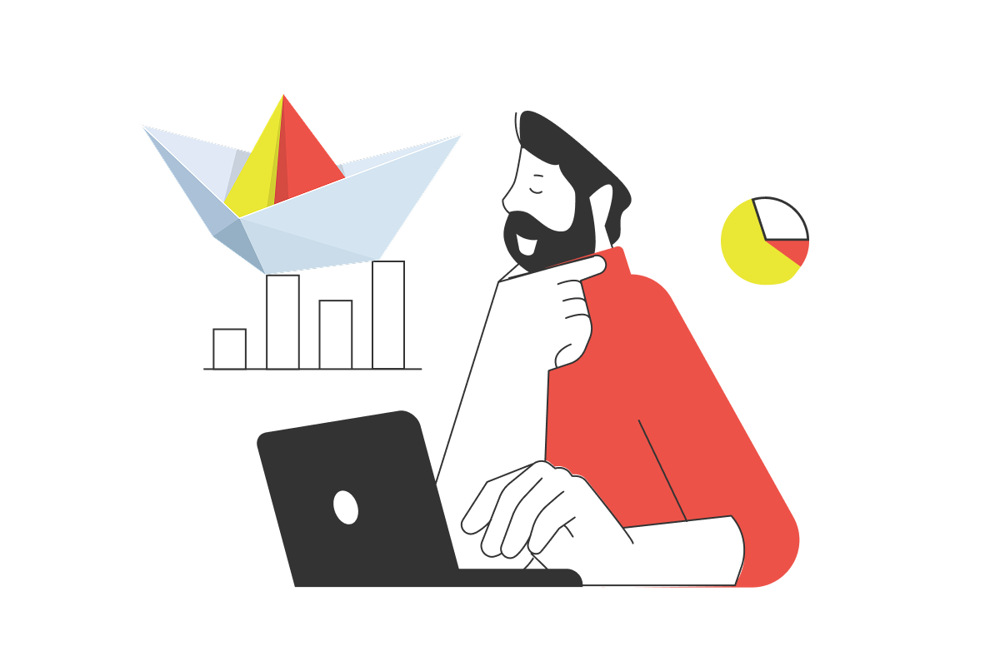<br>`data` | 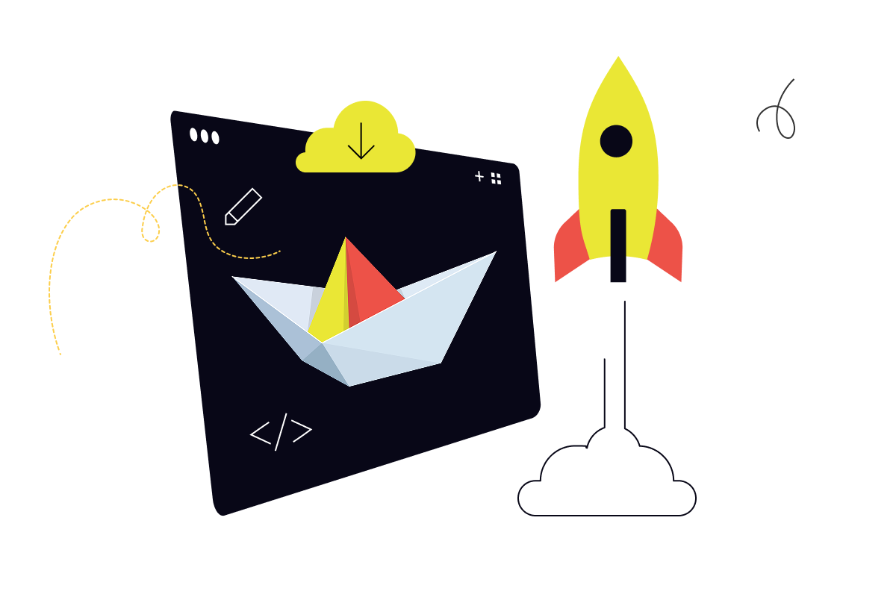<br>`performance` | <br>`search` |
| <br>`workflow-1` | <br>`workflow-2` | 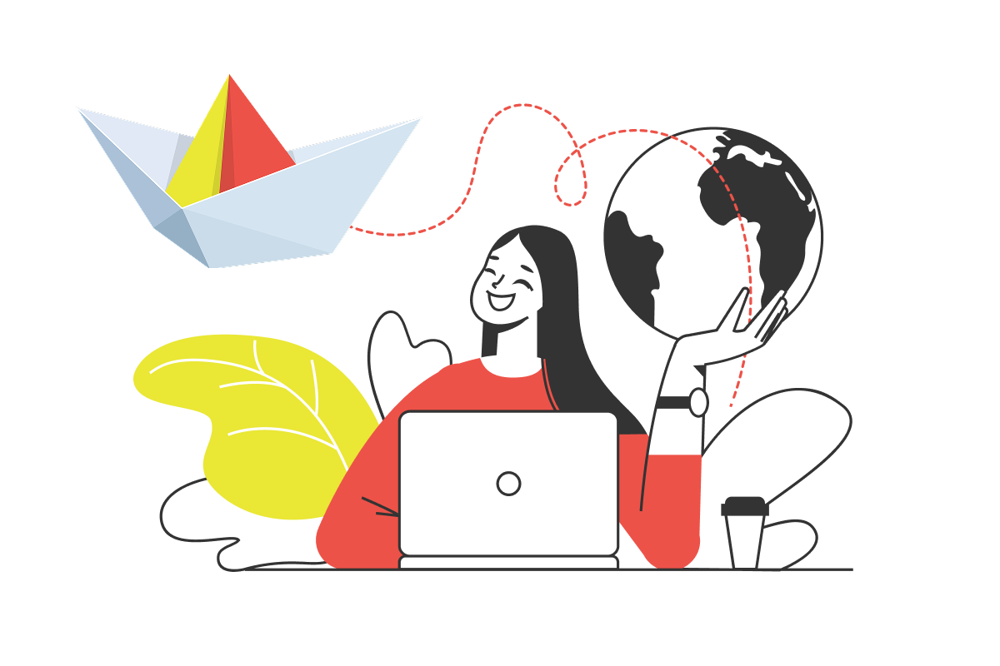<br>`workflow-3` |

All files: [`illustrations/2026/`](illustrations/2026/) · 1200 × 800 px PNG

**Suggested topics**

| Illustration | Good for |
|---|---|
| `collaboration-*` | Community, contributors, partnerships, events |
| `data` | Analytics, insights, data quality, case studies |
| `performance` | Releases, speed, deployment, cloud |
| `search` | Data discovery, search, developer and code topics |
| `workflow-*` | Publishing workflows, productivity, onboarding, tutorials |

<details>
<summary>Archive: 2022 blog header illustrations</summary>

An earlier illustration style, used for blog headers in 2022. They're kept here for reference. For new content, use the 2026 set.

| | | |
|:---:|:---:|:---:|
| 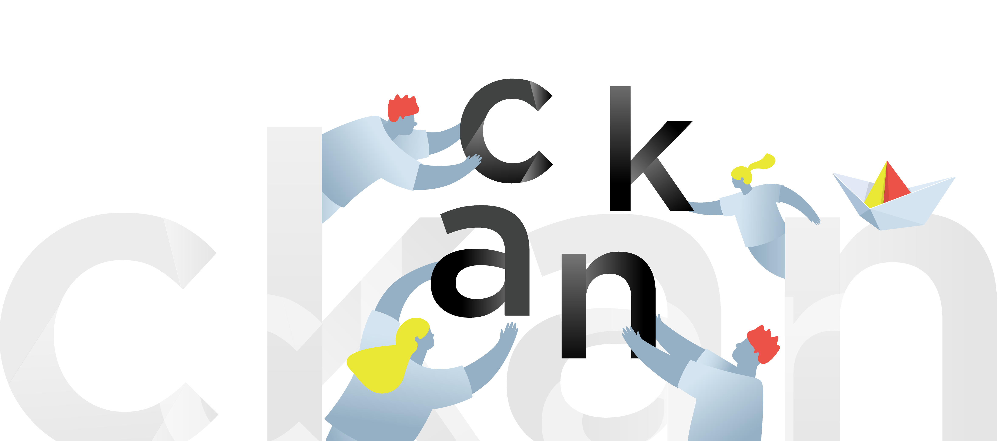<br>`ckan-community` | 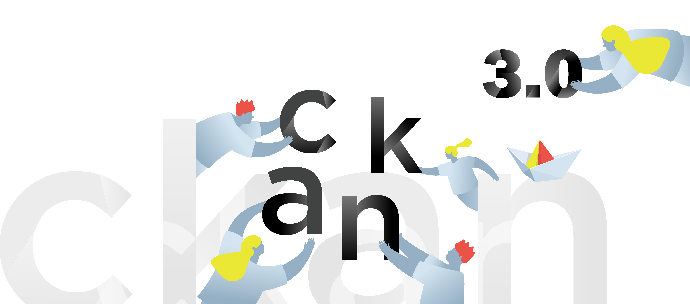<br>`ckan-3-0` | 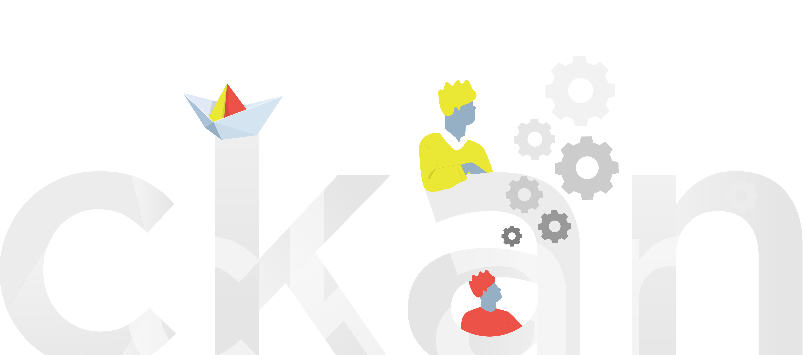<br>`supported-versions-policy` |

Editable Illustrator source files are in [`illustrations/2022-blog/source/`](illustrations/2022-blog/source/).
</details>

Design source (Figma): [CKAN.org blog post visualizations](https://www.figma.com/design/iDfXzrsgbDSuRxOLTc9CCa/CKAN.org?node-id=0-1)

---

## 📣 Social media

### Image sizes

| Format | Size | Use |
|---|---|---|
| Landscape | 1200 × 627 px (≈ 16:9) | Standard LinkedIn / X post, link preview |
| Square | 1080 × 1080 px (1:1) | Feed posts, carousels |
| Vertical | 1080 × 1920 px (9:16) | Stories, Reels, Shorts |
| Video | 1920 × 1080 px | Full-width video |

### Layout rules

- **Logo placement:** top right for horizontal formats, bottom centre for vertical ones.
- **Safe zone:** keep important content at least **5% away from every edge** so nothing gets cropped on different platforms.
- **Focal point:** centre the main illustration subject and crop with care so it still works at every aspect ratio.
- Make sure text in images is easy to read, and add captions to videos.

### Writing for social

The full guide is the [CKAN LinkedIn & X (Twitter) Style Guide](https://docs.google.com/document/d/1vzGiKLEtPCe_xYnYaCUOf83ykQWGTbIwlJKwKSKthHQ/edit). The essentials:

- **Lead with the point.** Put the key message first, then 2–4 supporting points, then evidence and a call to action (the Minto Pyramid).
- **Tone:** professional but approachable, concise and active. Avoid buzzwords like *revolutionise*, *game-changing* or *disrupt*.
- **Emoji:** 1–2 per post at most, used to signal something, not to decorate.
- **Hashtags:** 3–5 specific ones at the end, e.g. `#CKAN #OpenData #DataPortals #OpenSource #DataManagement`.
- **Always end with a clear CTA** ("Read the case study", "Try the demo", etc.).

---

## 🖥 Presentations & one-pager

Google Slides templates. Use **File → Make a copy**; please don't edit the originals.

| Template | What it is |
|---|---|
| [CKAN Presentation Template](https://docs.google.com/presentation/d/1f1lsECJ4IaMFqVmalPlWvv9UU7NQ3RrweWaP1QZ1jbA/edit) | The main branded deck for conferences, webinars and meetings, with 7 master layouts |
| [CKAN Presentation, Aug 2026](https://docs.google.com/presentation/d/1Mpt7jnKG-9nq_HBDcidVAgQZi1XYmO8WCHSFmaVlURA/edit) | The latest "about CKAN" deck, ready to adapt |
| [CKAN Presentation, 20th anniversary edition](https://docs.google.com/presentation/d/1VSllgTBEPC9s352n7c773sIPU7Eo7vz_m1FiqjMBCKM/edit) | Deck for the CKAN @ 20 campaign |
| [CKAN One-Pager 2026](https://docs.google.com/presentation/d/1tV6Njcsp8QgNlpjVTmOcBHMrl4pudbHlj5Xhb3lPR5I/edit) | A one-page overview with stats, features and notable users, for events, partner outreach and press |
| [CKAN Branding Guidelines 2026](https://docs.google.com/presentation/d/1QNzKmlIL-nYNwu06l2-ZnKbS6-orjtFVprx9EQKH6VA/edit) | The source for everything in this README |

---

## 🎉 CKAN @ 20

In 2026 CKAN turned 20. These anniversary assets are for the **#CKAN20** campaign. Use them alongside the primary logo, not as a replacement for it, and only for 20th-anniversary content.

<table>
  <tr>
    <th>Full</th>
    <th>Badge</th>
  </tr>
  <tr>
    <td align="center">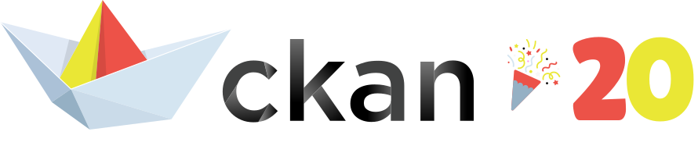</td>
    <td align="center">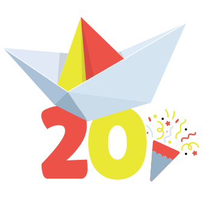</td>
  </tr>
  <tr>
    <td>Boat + wordmark + 20. Use it as the main anniversary logo.</td>
    <td>Stacked. Use it for square spaces, avatars and stickers.</td>
  </tr>
  <tr>
    <th>Icon</th>
    <th>Name</th>
  </tr>
  <tr>
    <td align="center">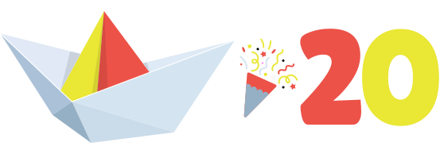</td>
    <td align="center">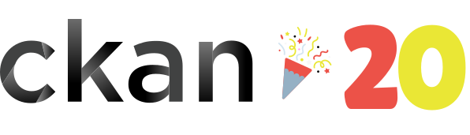</td>
  </tr>
  <tr>
    <td>Boat + 20. Use it where the CKAN name already appears nearby.</td>
    <td>Wordmark + 20. Use it in compact horizontal spaces.</td>
  </tr>
</table>

Every version is available as **SVG** in [`logos/ckan-20/svg/`](logos/ckan-20/svg/) and as **PNG @1x–@4x** in [`logos/ckan-20/png/`](logos/ckan-20/png/).

**Anniversary illustrations**

| | | |
|:---:|:---:|:---:|
| 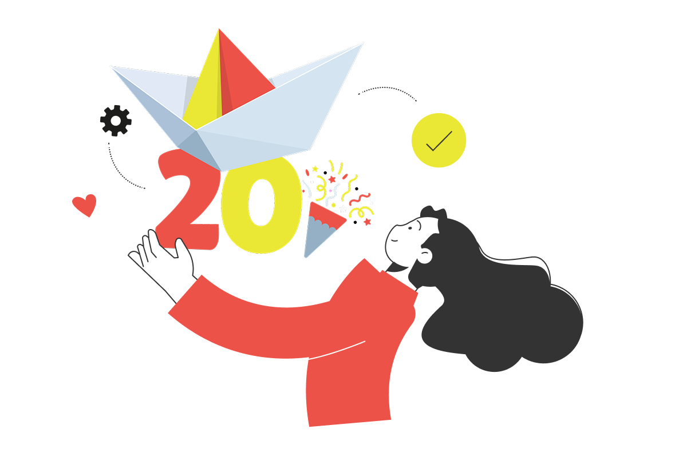 | 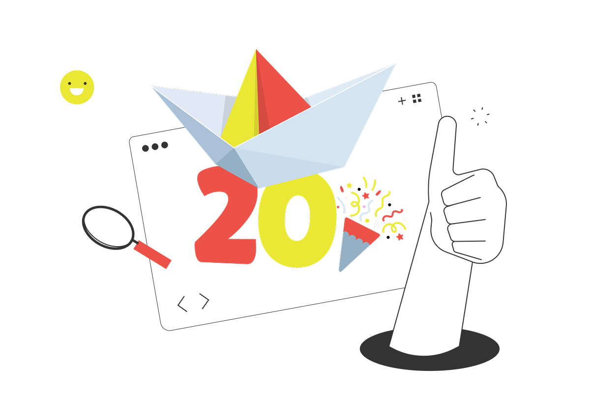 | 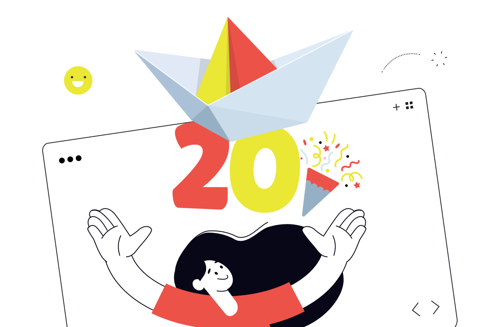 |

**Social templates:** "20 Years of Open Data"

| Landscape 16:9 | Square 1:1 | Story 9:16 |
|:---:|:---:|:---:|
| 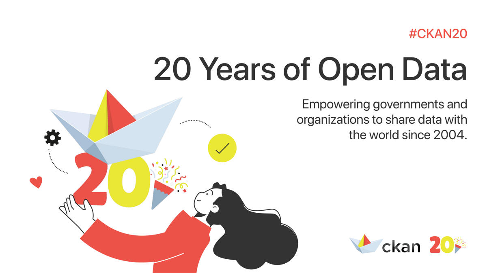 | 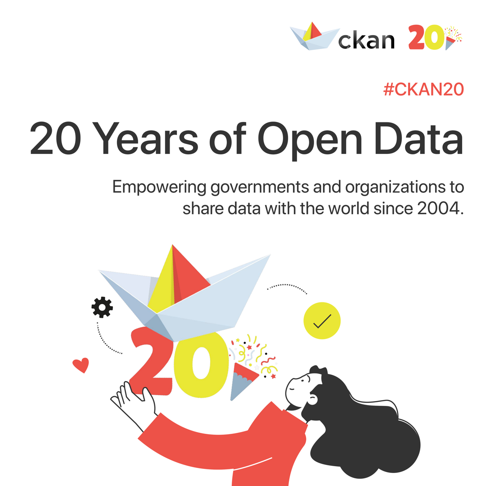 | 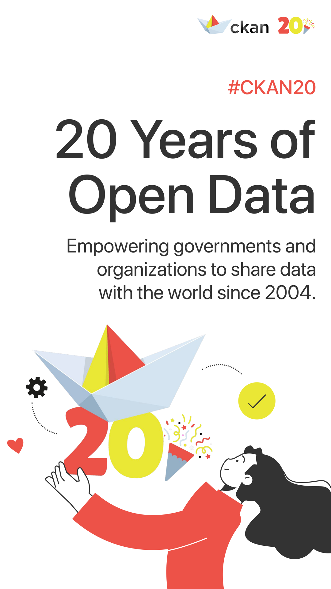 |
| [PDF](social/ckan-20/ckan-20-landscape-16x9.pdf) · [PNG](social/ckan-20/ckan-20-landscape-16x9.png) | [PDF](social/ckan-20/ckan-20-square-1x1.pdf) · [PNG](social/ckan-20/ckan-20-square-1x1.png) | [PDF](social/ckan-20/ckan-20-story-9x16.pdf) · [PNG](social/ckan-20/ckan-20-story-9x16.png) |

The full media toolkit is on [Google Drive](https://drive.google.com/drive/folders/1mJ9tDyxczCJtinauje7V04xHyhpJAHAn).

---

## 📁 Repository structure

```
ckan-marketing/
├── logos/
│   ├── primary/          # Main CKAN logo (SVG + PNG). Start here.
│   ├── variants/         # White, greyscale and boat-only versions
│   ├── extensions/       # "CKAN Extensions" lockup
│   ├── dpg/              # CKAN · Digital Public Good lockup
│   └── ckan-20/          # 20th anniversary logos (SVG + PNG @1x–@4x)
├── docs/                 # README swatches and previews (not brand assets)
├── illustrations/
│   ├── 2026/             # Current line-art illustration set
│   └── 2022-blog/        # Archive: older blog headers + .ai sources
└── social/
    └── ckan-20/          # #CKAN20 social templates (PDF + PNG)
```

**File naming:** lowercase, hyphen-separated, `<subject>-<variant>[@scale].<ext>`, e.g. `ckan-20-badge@2x.png`.

---

## 🤝 Contributing

- **Something missing or outdated?** [Open an issue](https://github.com/ckan/ckan-marketing/issues/new) in this repo.
- **Adding assets:** put them in the matching folder, follow the naming convention, include an SVG where one exists, and add them to this README in the same PR.
- **Questions about the brand or campaigns:** contact the CKAN communications team via an issue or on the [ckan.org](https://ckan.org).

<p align="center"><sub>Brand guidelines: 20th Anniversary Edition, 2026 · <a href="https://ckan.org">ckan.org</a></sub></p>
